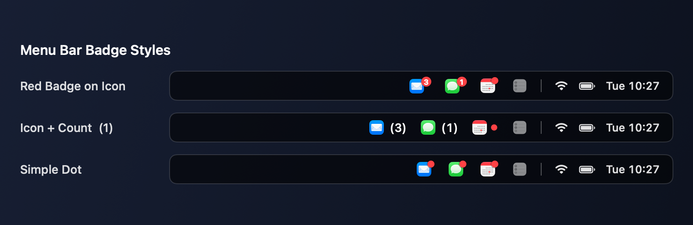
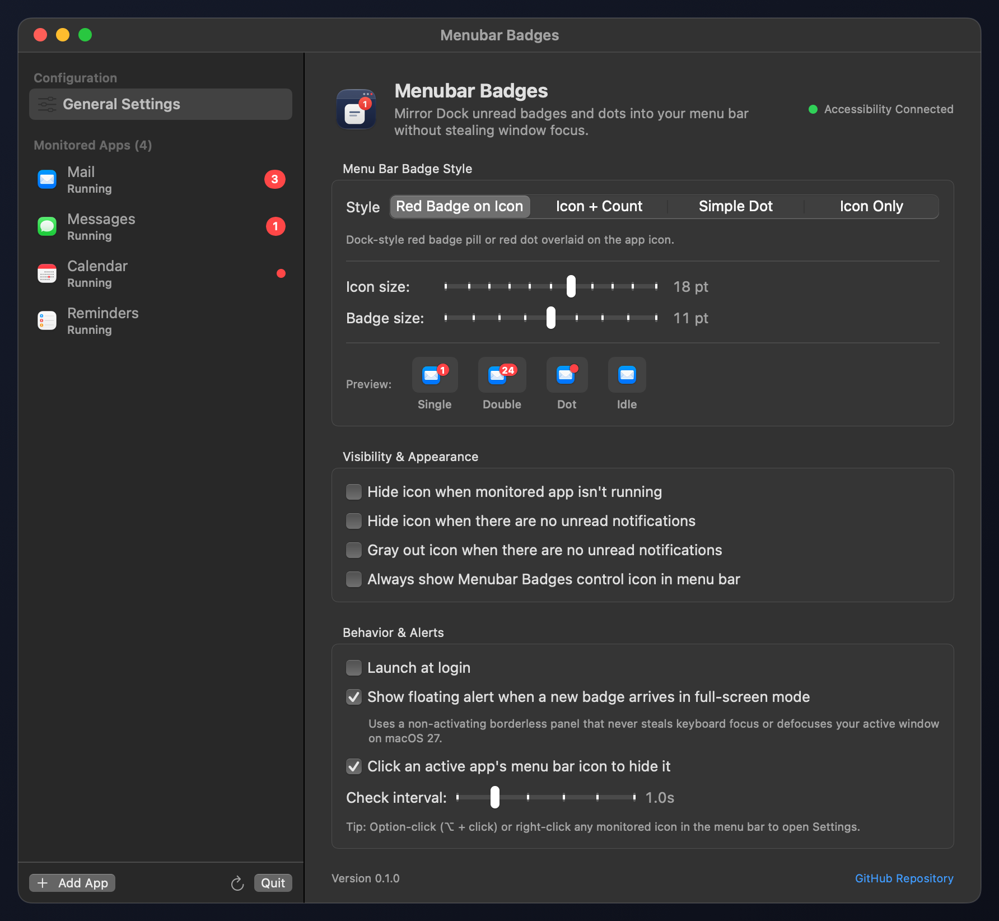
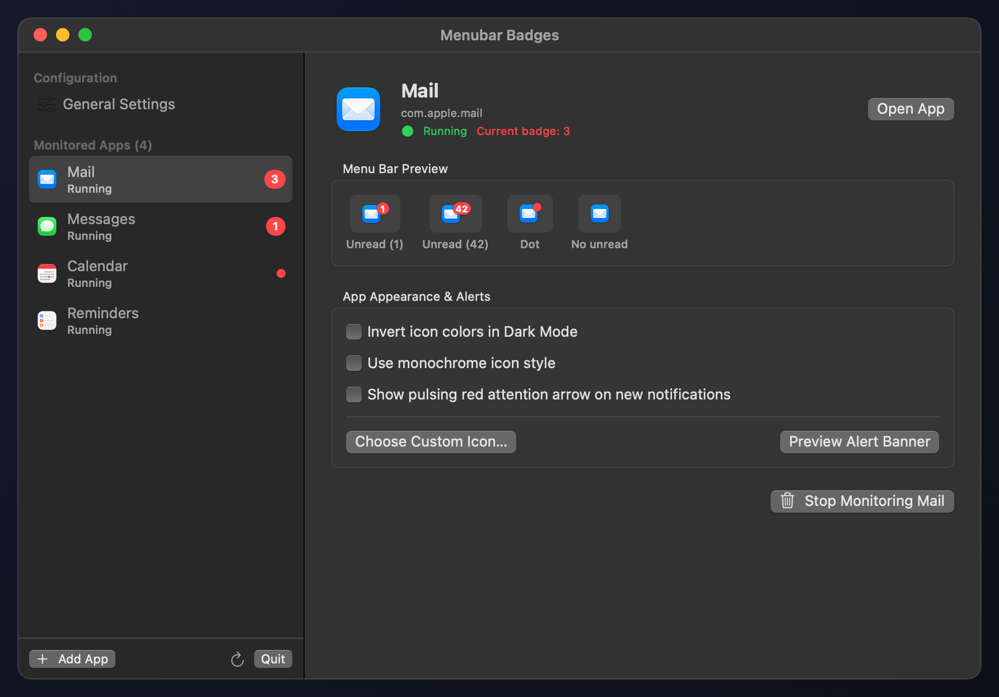

# Menubar Badges

A lightweight, native macOS menu bar app written in Swift that mirrors Dock unread badges — counts like `(1)`, red Dock-style badges, and simple unread dots — directly into your menu bar **without ever stealing keyboard or window focus** (including on macOS 27).

Inspired by [Doll](https://github.com/xiaogdgenuine/Doll), rewritten from the ground up with modern Swift 6 and macOS 27 focus-safety in mind.



## Screenshots

### General Settings
Configure badge styles, icon size & badge size, visibility rules, and non-activating full-screen alerts:



### Per-App Settings
Live previews and per-app overrides (dark mode invert, monochrome style, custom icon, pulsing attention arrow):



## Why Menubar Badges?

- **Zero Focus Stealing on macOS 27**: Legacy menu bar badge apps used `NSPopover` anchored to `NSStatusItem` for full-screen alerts and mutated status items on every poll. On macOS 27, showing an `NSPopover` from the menu bar steals system keyboard focus (`AXFocusedApplication`) away from your active window. Menubar Badges uses a custom borderless `NonActivatingPanel` (`canBecomeKey = false`, `canBecomeMain = false`) and idempotent state-diffed status item updates so your active window never loses focus.
- **Multiple Badge Styles + Configurable Sizing**:
  - **Red Badge on Icon** — Dock-style red pill/circle badge with dynamic width (no double-digit truncation) or crisp red dot for `•` badges.
  - **Icon + Count** — App icon followed by `(1)`, `1`, or a crisp red dot using `NSStatusItem.variableLength`.
  - **Simple Dot** — App icon with a minimal red unread dot whenever any badge is present.
  - **Icon Only** — Clean app icon (pairs great with *Hide when no unread* or *Gray out when no unread*).
  - **Icon Size & Badge Size** — Fine-tune icon size (`12–22 pt`) and badge size (`7–15 pt`) with live preview.
- **Reliable Dock Matching**: Matches Dock items by bundle identifier (`AXURL`) first rather than fragile localized title-only matching, and automatically re-arms Dock Accessibility observers if the Dock process restarts.
- **All Essential Features**:
  - Left-click any icon to jump straight to the app (or hide it if it's already frontmost).
  - Option-click (`⌥` + click) or right-click any icon for Settings & quick actions.
  - Hide icons when the app isn't running or when there are no unread notifications.
  - Gray out icons when idle, invert icons in Dark Mode, monochrome mode, or upload custom app icons.
  - Optional non-activating full-screen alert banner and per-app pulsing attention arrow.
  - Launch at login (`SMAppService`).

## Install

1. Download the latest `MenubarBadges-*.dmg` from [GitHub Releases](https://github.com/gempir/menubar-badges/releases).
2. Open the DMG and drag **Menubar Badges** into **Applications**.
3. Launch **Menubar Badges** and grant **Accessibility** permission in **System Settings → Privacy & Security → Accessibility** so it can read Dock badge labels.
   - *Note*: Because this open-source build is ad-hoc signed, macOS Gatekeeper may ask you to right-click → **Open** (or allow it under **Privacy & Security**) on first launch.

## Building from Source

Requires macOS 13+ and Swift 6 / Xcode.

```bash
# Run unit tests
swift test

# Build release MenubarBadges.app into ./dist/MenubarBadges.app
./Scripts/build-app.sh 0.1.0

# Build distributable DMG into ./dist/MenubarBadges-0.1.0.dmg
./Scripts/build-dmg.sh 0.1.0

# Run live macOS focus-safety verification
./dist/MenubarBadges.app/Contents/MacOS/MenubarBadges --verify-focus-safety
```

## License

MIT — see [LICENSE](LICENSE).
